# Architecture

`sisu` compiles one Sisu source file into one native executable. It is a
pipeline: each stage takes what the previous stage produced and hands on
something closer to machine code. The stages run in one process, with LLVM
linked in as a library. Only the final link runs a separate program, the
system C compiler `cc`.

<picture>
  <source media="(prefers-color-scheme: dark)" srcset="architecture/sisu-pipeline-dark.svg">
  
</picture>

This page stays at the level of stages and the data between them. The code
and its comments hold the detail, and [GLOSSARY.md](../GLOSSARY.md) defines
the terms.

## The stages

**Driver** (`crates/sisuc/src/lib.rs`). Reads the command line, runs the
stages in order and prints diagnostics. `args.rs` parses the command line with
clap into a `Mode`, one per subcommand plus `--version` and the usage, and `run.rs`
links a program into a private temporary directory, runs it and removes the
directory. The `sisu` binary (`main.rs`) runs it on a thread with a 64 MiB
stack, and allocates with mimalloc. It reads at most 1 GiB of source,
so every span offset fits in a `u32`; a larger file is a tool error. The
commands `check` and `build` (without `--emit`) do not free the typed program,
the mir or the LLVM module: the process exits soon after, and the OS frees all
of its memory faster. `--emit`, `run` (which waits for the program) and the
fuzzer free them.
`fuzz.rs` runs the `check` path on raw bytes and asserts that every
diagnostic span and fix edit is well formed, and that every safe fix, applied
alone, deletes no comment and removes its diagnostic and no other. For an
input that checks clean, it also prints the typed tree, builds its mir and
runs codegen, and LLVM must verify the module. The program fuzzer adds two
modules, compiled only in tests and under the `fuzz` feature: `generate/`
turns fuzz bytes into a well-typed program, its standard input and a rewritten
copy that must print the same, and `fuzz_program.rs` builds both at O0, at
`-O2` and with `--rc-checks`, runs each build and judges the runs
([ADR 0033](adr/0033-every-language-feature-has-a-generator-rule.md)).
`sisu check` and `sisu build --emit`
stop the pipeline early, as
[Developing Sisu](development.md#look-inside-the-compiler) lists.
`--format json` switches the diagnostics to JSON Lines, and `sisu explain <code>`
prints the explanation of a code and runs no stage.
`--timings` on `sisu build` and `sisu check` makes `timings.rs` record the
wall time of each stage that runs, and `report.rs` prints it to stderr.

**Lexer** (`lexer/`). Turns source text into tokens. A line break that can
end a statement becomes a `Newline` token, because statements end at
newlines ([ADR 0001](adr/0001-newline-terminated-statements.md)). A `;`
between two statements on one line becomes a `Newline` too, and an
unnecessary one, such as a `;` at the end of a line, is dropped with W0007
([ADR 0028](adr/0028-a-semicolon-stands-in-for-a-line-break.md)). A `>` at
a line's end ends the statement when it closes a type annotation, as in
`b: Box<i64>`, or the type that `type Item = Box<T>` chooses. Any other `>`
there lets the line go on: a comparison, a header's type parameters, or a
call's type arguments. A `??` at a line's end follows the same rule: it ends
the statement in `b: i64??`, and otherwise the line goes on to the operand of
`??`. The lexer decodes a `char` literal and its escapes into one scalar value, and a string
literal into its text, so later stages never see the escape text. An integer
literal's token holds only its value; a diagnostic that quotes the literal as
written slices the source with its span. A string with `{expr}` parts
becomes a `StrHead` token, the expression's tokens, and `StrMiddle` or
`StrTail` tokens for the text between and after them. A `:` that ends an
interpolation's expression starts a `FormatSpec` token, which holds the spec's
text. The lexer interns each
name into a `Symbol` (`symbol.rs`), so the parser and checker copy, compare and
hash names as integers; `tir` and diagnostics hold the text as a `String`. After most errors
the lexer skips the bad text and goes on, so it records every one of them,
and the parser keeps the earliest per item. A bracket that is unclosed or does
not match is the exception: the run then reports one diagnostic and the parser
and checker do not run. A literal that is not closed can eat the closers after
it on its line, so after one, a closer also closes the brackets above its
opener that were opened before the literal, and the run goes on.

**Parser** (`parser.rs`, `ast.rs`). Turns tokens into a syntax tree, the AST.
It reports one error per broken item, then resumes at the next item. The
intact items go on to the checker, and a broken item keeps its name, so a use
of it is not reported as missing, and a second item of that name is reported
as defined twice. It parses a format spec's text into its alignment, width and precision, and
reports a malformed or unsupported one without breaking its item. An `enum` item parses into its variants, each with
an optional payload of labeled or unlabeled fields, and its methods. A `match`
parses into its scrutinee and its arms, one per line, each a pattern, an
optional `if` guard, `=>` and a body; a pattern is one or more alternatives
joined by `|`. `if let` and `while let` take a pattern too, and so does
`let pattern = value else { block }` ([ADR 0044](adr/0044-let-else-and-jumps-are-expressions.md)).
The parser reads the value first, so a value that ends in `}` before `else` is
E0173 with a fix that puts the value in `( )`. The parser keeps a pattern with
no `else`; the checker reports it, as E0174 or by the value's type. `return`,
`break` and `continue` are expressions, not statements. Each one takes
everything to its right that an expression can take, so
`a ?? return b ?? c` is `a ?? return (b ?? c)`. A jump at the end of the header
of an `if`, `while`, `for` or `match` that would take the body's `{` as its
value is an error at the jump. A `name:` before
`loop`, `while`, `while let` or `for` is a loop label, which stays open to the end of
that loop's body; after `break` or `continue`, a name is the loop label when a
loop around the jump has it, and otherwise begins the value
([ADR 0034](adr/0034-loop-and-loop-labels.md)). A function, class
or enum header may take type parameters, `<T, U>`, and a type may take type
arguments, `Stack<i64>`. A type parameter may take bounds, `T: Shape & Named`.
An `interface` item parses into its type parameters, the interfaces it
inherits after a `:`, and its requirements: a method signature with no body,
or an associated type, `type Item`. A class or an enum lists the interfaces it
conforms to after its name, `class Circle: Shape`, and may choose an
associated type, `type Item = i64`. An `extend` block,
`extend<T> Stack<T>: Eq { ... }`, parses into its type parameters, its target,
an optional interface and its methods; a broken one keeps the name of its
target. A `type Name<A, B> = T` item, a type alias, parses into its name, its
parameter names, which take no bounds, and the type it names; it ends at its
line, as a `const` does. In a type, `Self` is the conforming type, `S.Item`
is an associated type, `any` before an interface name makes an interface value
type, `any Shape`, and a type may stand in parentheses, `(any Shape)?`. `any` is
a keyword only there, so `xs.any(...)` still names a method; `any Shape?` and
`any A & B` are E0165. In an expression, a `<` after a name starts type
arguments only when the tokens up to its `>` read as types and a `(` or `.`
follows, as in `first<i64>([])`; any other `<` compares. A `>=` that closes a
list, as in `let s: Stack<i64>= x`, splits into the `>` and the `=`. It rejects an item that nests deeper than
256 levels, because every later stage walks the tree recursively.

**Front end** (`front_end.rs`). Runs the lexer, parser and checker in order,
then `mono`, and returns the program and every diagnostic, in position order:
the checker's are merged in by position. The checker runs only when
every item has a name. `mono` reports E0030 for an associated type chain that
the checker's probe did not follow, and the front end then gives no program.
`sisu check` stops after the checker (`front_end::checked`), because it prints
no instantiation, so it does not find such a chain. `mono` also reports E0160
for a payload that can be 4 GiB or more (`payload_limit.rs`) when the checker
cannot measure it: an enum that holds an instance of a generic enum, or is one.
The checker finds the error for the other enums, so `sisu check` reports those.
`mono` reports E0163 when the program reaches more than 100,000 instances, and
`sisu check` does not report it.

**Checker** (`check/`, `tir.rs`). Resolves every name, types every expression
and lowers sugar: `while`, `while let` and `for` become loops, `?.` and `??`
become `if let`, and `x += 1` becomes `x = x + 1`. A `+=` on a string field
or element, or an assignment that adds to its own field or element place,
becomes an `Append`. A local keeps `Assign` with `Concat` and appends in place
through `concat`'s count-1 path. A `push` on an array becomes a `Push`, and
`xs?.push(x)` becomes a `Push` on a `Some` place, not an `if let`. It folds
each top-level `const` to a literal and replaces every use of its name with that literal. A call to one of the
built-in prelude functions, `print`, `eprint`, `panic`, `read_line` and `dbg`,
has its own rule, and `panic(msg)` and
`todo` become a `Panic` node of type `never`. A format spec on a part becomes a padding and a precision, and a precision on a
value that is not an `f64` is an error. A method on an `f64`, such as
`x.sqrt()` or `x.max(y)`, becomes a `Math` node, and a constant such as
`f64.pi` becomes a literal. The prelude file may extend a built-in type, and a
user's file may not (E0155). So `i64`'s `min`, `max` and `clamp`, the `sum` of
an `[i64]` or an `[f64]`, and the `contains` of a `[T]` with `T: Eq` are
functions that the prelude writes in Sisu, and a call of one is a call of that
function. `check/enums.rs` declares each enum and rejects an
enum that no value can be built of. `tir::layout_enums` then finds the payload
fields that close a cycle of enums, the ones that go behind a box, and the
enums that hold a counted part. In a generic enum the box goes on the declaring
enum's own field, not on one inside a generic type it names. Building a variant, `Expr.Num(2)`, becomes a `Variant` node
([ADR 0019](adr/0019-enums-are-values-named-through-their-enum.md)).
`check/names.rs` owns the maps from a top-level name to its item. Each position asks it one
question: what the name means here. The positions are a value, a callee, a type, a bound, a
pattern, a path and a path call. Each has an order of its own for the meanings, and a path and
a path call share one. The module also poisons a rejected or broken item, so a use of it gives
no error of its own
([ADR 0049](adr/0049-one-name-resolver-and-one-poison-rule.md)).
`check/expectation.rs` holds `Expectation`, what the context expects of a value: nothing, a
required type, a poisoned context (`Poisoned`), or a hint. The siblings of a value give it a
hint, and an operator hints its operands that wait for context. A hint holds at one value and
the parts that give the value. An operand does not see the hint of the value that holds it. A
mistake that follows from a poisoned context waits for the next run.
`check/pattern.rs` checks each pattern against the type at its position and
declares the names it binds. `if let` on an enum becomes a `match` whose `_`
arm is the `else`, and `while let` on one a loop around a `match` whose `_` arm
breaks. `check/stmt.rs` checks a let-else as one `tir::Stmt::LetElse`, not as
sugar: the value and the pattern go through the code of `if let`, the `else`
block is checked before the pattern binds anything and in its own scope, and
the names go in the enclosing scope. An `else` block that can finish is E0172.
A `return`, `break` or `continue` is an expression of type `never`, and
a jump where a value must be used is E0043. A `break` or `continue` names its loop in `tir` by depth, the number of
loops out from the innermost, and a `break` may carry a value; the loop's type
comes from its `break`s, and `while true` gets W0009. A `while` whose
condition nothing in the loop changes gets W0011. `check/exhaust.rs` runs
Maranget's usefulness algorithm over each
`match`'s arms: a `match` that misses a value is an error that names one it
misses as a pattern, such as `Mul(_, _)`, and an arm that no value reaches is
a warning. The same check rejects an `if let` or `while let` whose pattern
always matches. `check/recursion.rs` walks the `tir` of each function and gives
W0010 when the function calls itself on every path. After a check with no
error, `check/unused_names.rs` walks the uses that the checker records, out
from `main` and each function, method and constant whose name starts with `_`.
It gives W0012 for an item or an `extend` block that no live code uses, W0013 for a field that live
code does not read or a variant that it does not build, and W0014 for a local
or parameter of live code that nothing reads. `check/operator.rs` checks operators (arithmetic, comparison,
equality, `is` and `??`), `check/branch.rs` `if` and `if let` and the join of
their branch types, `check/call.rs` calls, method calls and constructors, and
`check/member.rs` fields and methods found through `.` and `?.`,
including the methods of `extend` blocks.
`check/alias.rs` resolves each type alias before any signature, each after the
aliases that its body names, so a chain of any length needs no recursion; an
alias that reaches itself is E0161. An alias is a `Type`, never an item: a use
is `Type::subst` of the body over the arguments, through one memo for the whole
check, and the body names its parameters by place, so an alias applied to its own
parameters is its body. A written type stops at 256 levels (E0071) and at
100,000 distinct types (E0162). A bound or an associated type in a body that names
a parameter is checked at each use. A class, an enum, an optional or a number
type that an alias names answers a constructor, a variant or a member as the
type does, so later stages see no alias.
`check/generic.rs` handles type parameters. It checks a generic function,
class or enum once, at its definition, with each type parameter an opaque
`TypeKind::Param`. A value of a type parameter can be moved, stored, passed,
returned, put in an array or a field, wrapped in `T?`, and called with the
methods of its bounds. An operator on one needs a bound that gives it:
`Eq` gives `==` and `!=`, and `Ord` gives `<`, `<=`, `>` and `>=`. Without
the bound, the operator is E0139. A call takes its type arguments written out, or
infers them from its receiver, its arguments and the expected type. `tir`
keeps the type parameters, and a call records the type arguments it chose.
`check/interface.rs` declares each interface, with its type parameters,
requirements and inherited interfaces, and reads each bound. A bound gives
the interfaces it names and every interface they inherit. `check/conform.rs`
records the conformances that a class or an enum lists and that an `extend`
block writes, and checks that each meets its requirements and the
conformances it needs (E0152, E0154). `check/extend.rs` finds the methods of
an `extend` block, and `check/assoc.rs` the associated types that a
conformance chooses: it replaces an associated type of a known type with the
type its conformance chose. `check/bound.rs` checks a method call on a value
of type `T`: the name is a requirement of the interfaces of `T`'s bounds, and
the call becomes an `InterfaceCall` node in `tir`. `conformance.rs` finds the
conformance that covers a type, for the checker and for `mono`.
`check/any.rs` handles interface values. `any I` is `TypeKind::Any`. An
interface cannot be `any` when it, or an interface that it inherits, has a
generic method, a `Self` besides the receiver, an associated type, or an
inherited interface with `Self` in its arguments (E0164);
`why_not_any` keeps each answer, so a long chain of inheritance costs no more
than its length. A value converts to an `any` type wherever the checker expects
one: an annotation, an argument, a field, an element, a `return`, a tail, an
assignment, a branch join, a `break` value, a `??` default and a variant
payload. It gets a `ToAny` node when its type conforms to `I` and is not an
optional. An `any I` conforms to `I`, to every interface that `I` inherits and
to `Display`; a program cannot write or replace that conformance (E0155), and
`==` on one is E0159. An argument binds a type parameter before the expected
`any` type does (`check/generic.rs`). A method call on an `any` value is an
`InterfaceCall`, as through a bound. The walks that
follow the depth of a type grow the call stack when it is low (`stacker`), so a
deep type does not overflow it. A type argument that does not conform to a bound is an error at the call (E0154).
The interfaces `Display`, `Eq`, `Ord` and `AnyObject` are in `lang.sisu`,
which the front end checks before the prelude. `print`, `eprint`, an
interpolation and `to_string()` use `Display`, `==` and `!=` use `Eq`, and `<`,
`<=`, `>` and `>=` use `Ord`. The compiler writes the conformances of the
numbers, `bool`, `char`, `string`, arrays, optionals and enums, and a class
gets only the ones its program writes (E0152, E0159). `lang.rs` makes the
`tir` of an operator for a type it knows: the node that the operator always
had when the compiler wrote the conformance, and a call of the method when a
program wrote it. Only a class conforms to `AnyObject` (E0158), and `is` on a
`T: AnyObject` tests identity. `print` of an optional gives W0015 and
`to_string()` does not
([ADR 0036](adr/0036-every-type-prints-and-printing-an-optional-warns.md)).
`check/cycle.rs` then rejects a program whose instantiations would never end
(E0140). Its graph has a node for each type parameter of every declaration,
a node for each interface, and an edge for each type argument that names a
parameter, with a weight: the depth at which the argument nests the
parameter, so `[T]` for `T` weighs 1. A call through a bound reaches every
conformance of its interface. A cycle with a total weight above zero is the
error ([ADR 0023](adr/0023-generics-are-monomorphized-and-checked-at-the-definition.md)). The checker
goes on after an error. A second mistake in one expression can wait for the
next run. Most expressions that fail return a poisoned value. The goal is that
one mistake gives only true errors
([ADR 0049](adr/0049-one-name-resolver-and-one-poison-rule.md)). A failed call
keeps the result type that its callee gives when the arguments do not decide
it. Then the checker still checks the code that uses the value. A program with
no errors comes out as the typed tree, `tir`, which `mir` is built from. A type
in `tir` is a 4-byte `Type` handle into one table (`types.rs`), as a name is a
`Symbol`; its `kind()` gives the structure, and equal structures get the same
handle.

**mono** (`mono.rs`). Monomorphization. Starting from the declarations that are
not generic, it copies each generic function, class and enum once for each list
of type arguments the program reaches, and substitutes the arguments into every
type. Each copy is named as a program writes it: `first<i64>`,
`Stack<string>.peek`, `Tree<i64>`. A method is copied only when a call reaches
it, never with its class. `mono` then lays out the enums again with
`tir::layout_enums`, because an instantiation can close a cycle of enums that
no declaration has. A call of a requirement through a bound is an
`InterfaceCall` in `tir`; `mono` replaces it with a call of the method of the
conformance that the type argument has, so `total<Circle>` calls `Circle.area`
directly and dispatch is static. It does the same for an operator on a `T`,
through `lang.rs`: `a == b` on a `T` that is a `Circle` with a written `Eq`
calls `Circle.eq`. It replaces an `InterfaceCall` on an `any`
receiver with a `DynCall`, a call through the table of the value, and each
`ToAny` makes it reach every method in the table of the converted type; a
`ToAny` whose operand already has the target type is removed. It also
replaces each associated type with the type its conformance chose. It reports E0030 for a chain of more than 128
choices, or a loop, that the checker's probe did not follow, and then gives no
program. It counts each instance it makes and stops with E0163 when the count
passes 100,000 (`INSTANCE_LIMIT`), because a chain of generic items can double
the instances at each step. A method of an `extend` block that names an
interface has the interface between its type and its name,
`Celsius.Convert<Fahrenheit>.convert`, so two conformances may each hold a
method of one name. `mir` and codegen see only concrete types, and a program
with no generic declaration passes through, apart from those method names.
The first line of `--emit tir` says whether `mono` took this fast path.
`mono` starts from the user's functions only. A prelude function joins the
program when a function that the program has calls it. `--emit tir` prints the
program after `mono`, with the prelude functions that it reaches.

**mir** (`mir/`). The mid-level IR between `tir` and LLVM IR
([ADR 0025](adr/0025-mir-holds-every-count.md)), built on the build path only,
so `sisu check` does not pay for it. `mir::build` lowers each function of `tir` to
typed locals and basic blocks in which every copy, move and release is its own
statement (`lower.rs`). Parameter inference (`params.rs`,
[ADR 0029](adr/0029-parameters-are-borrowed-unless-consumed.md)) then searches
the whole program for the counted parameters that their functions only read,
marks them borrowed, and rewrites each call to pass such an argument in place;
a function that tests a parameter that came out owned with `match` or `if let`
is lowered again. The call graph's strongly connected components come from
`graph.rs`, which the checker's search for recursive enums shares. The reuse
pass (`reuse.rs`, [ADR 0030](adr/0030-match-takes-its-scrutinee-apart.md)) runs
next, before the ownership pass, and builds each box of a construction into the
block that a `match` arm took apart when it held that box alone. The
ownership pass (`ownership.rs`) then decides each read of a counted local by liveness (`liveness.rs`): a read that is the local's
last use moves its reference instead of sharing it, so a later write to the
array it holds can skip the copy
([ADR 0007](adr/0007-arrays-are-values.md)). The hoist (`hoist.rs`) moves the
`make_unique` of an array a loop writes to the loop's pre-header
([ADR 0021](adr/0021-a-loop-makes-its-written-arrays-unique-before-it-starts.md)).
An array `push` is a statement of its own: it decides on the block's count itself, so
the hoist neither moves it nor bars its array, and it counts as a clobber for pair
removal and for the quiet functions of the prelude. A `push` through `?.` onto an optional
array tests it before its argument and again after the argument, which may have cleared it.
The certifier (`certify.rs`) proves each `Some` of the written path with such a test.
Elaboration (`elaborate.rs`) then removes each scope release that only empty
paths reach and makes one that only owned paths reach a plain release, so
codegen stores the zero value on a move only for a local that a conditional
release still tests (for every local under `--rc-checks`).
Pair removal (`pairs.rs`) then turns a copy that is only borrowed within a block
into a borrow, and its release into an `end`. A slice of such a copy that is not
`safe` reads it in place and holds no count; a `safe` slice keeps its copy. A
call of a prelude function that writes and frees nothing its caller can reach is
a quiet call (`params::quiet`), and a copy can become a borrow across it. A user
function is never quiet.
Debug builds of the compiler end with the certifier (`certify.rs`), which
checks on every path that each owned reference is moved or released once and
that nothing writes or changes what a borrow reads.
A call through the table of an `any` value (`dyn_call`) has a fixed convention, not an inferred
one: its receiver is borrowed and every other argument is owned, and the entry of the table adapts
to the method's own flags. It may run any written method, so it is a clobber, as a call is. A
conversion to `any` (`to_any`) consumes its operand.
`tir` carries no moves. `--emit mir` prints the result.

**Codegen** (`codegen/`). Walks `mir` and builds an LLVM module through the
[inkwell](https://github.com/TheDan64/inkwell) bindings. Each Sisu function
becomes an LLVM function named `sisu.<name>`, and each method of a class or an
enum one named `sisu.<Type>.<method>`; an instantiation keeps the name `mono`
gave it, as in `sisu.first<i64>`, `sisu.Stack<string>.peek` and
`sisu.Celsius.Convert<Fahrenheit>.convert`. Codegen also emits a `main` with the C
signature,
which the C startup code calls and which runs `sisu.main`, passing it `args`,
a `[string]` built from `argc` and `argv`, when `sisu.main` takes that
parameter. Integer overflow
and division by zero call `sisu_panic` instead of wrapping
([ADR 0003](adr/0003-arithmetic-panics.md)). A `Panic` node, which `panic`
and `todo` lower to, calls `sisu_panic_message` with its location and
message, then ends the block with `unreachable`. Codegen gives each prelude
function two more last parameters, a pointer and a length: the source location
of its caller. A panic in the function reports that location, so it names the
user's call and not a line of the prelude. The helpers that call a written
`to_string` or `eq` of a prelude type pass the location `<prelude>`, because
one helper serves every caller of its type. A `Math` node becomes an LLVM
intrinsic, except `hypot`, which calls `hypot` from `libm`.

`codegen/abi.rs` declares every runtime function from one table, `RUNTIME`,
of names, types and attributes. A unit test reads the runtime's source and
fails when an export has no row, or a row's types differ from its signature.
`sisu_alloc` and `sisu_free` carry LLVM's allocator attributes as a pair. At
`-O2` LLVM may delete an allocation and its free, including when it can compute
every value the program reads without the heap block, such as an array's length
or an element of a fill. The largest allocation the size checks allow
(about 2^63 bytes) aborts with exit code 134 when its allocator call remains;
at `-O0` every such allocation aborts. On Linux, a smaller request that the
machine cannot back can succeed in a default build, because mimalloc maps
memory without reserving it and the kernel overcommits; the program may then
end with 137, from the out-of-memory killer, once it touches memory the
machine cannot back. An allocation can still fail at once with 134, when the
kernel refuses a request far beyond RAM plus swap
([ADR 0031](adr/0031-compiled-programs-allocate-with-mimalloc.md)).

`codegen/layout.rs` holds how a value sits in memory: the LLVM type of each
Sisu type, the layouts of an object, an array block and a string block, the
count word (`load_count`, `store_count`, `init_count`), the optional accessors
(`empty`, `has_value`, `optional`, `optional_value`), the niche of an optional
(`niche`): the spare payload value that holds its `None`, the three words of an
array or string value (`value_block`, `value_data`, `value_len`, `make_value`,
`load_words`), the size of every heap block (`heap_size`), and the TBAA tags with
the tagged loads and stores that use them.

Objects live on the heap, with a reference count in front of their fields
([ADR 0005](adr/0005-reference-counting.md)). Codegen lays the fields out
largest alignment first, and fields of equal alignment in declared order, so
less padding sits between them; `tir` and every diagnostic keep declared
order. Codegen emits the helpers that
manage them: `sisu_rc.retain`, and for each class `sisu_rc.release.<Class>`
and `sisu_rc.drop.<Class>`. A class in a cycle of classes that hold each other
in direct fields, `X` with any number of `?` around it, frees the objects of
the cycle from pending lists, linked
through the dead count word. So a chain of any depth drops in one frame. A
cycle of two or more classes shares one `sisu_rc.drain.<Class>` helper, named
after its first class. A class gets `sisu_rc.eq.<Class>` only when its program
writes an `Eq` for it and `==` on an array or an enum of it needs the helper.
The helper calls the written `eq`; a class has no generated `==`
([ADR 0022](adr/0022-classes-compare-by-identity.md)). A field
read and a field assignment tag their load and store with a TBAA tag of that
field's own, `<Class>.<field>`, so LLVM knows that writing one field changes
no other field, and no count, length or element.

An enum value has no heap block of its own. It is a tag and its variant's
payload, held inline in `%sisu.<Enum>`, with a struct `%sisu.<Enum>.<Variant>`
per variant laid over the payload storage. An enum with no field in any variant
is its tag integer, with no struct. A payload field that closes a cycle
holds a box instead: a counted heap block, `%sisu.box.<Enum>`, that holds a
value of the enum. Each enum gets `sisu_rc.eq.<Enum>`, and an enum with a
counted part also gets `sisu_rc.retain.<Enum>` and `sisu_rc.release.<Enum>`,
which switch on the tag. A box whose count reaches zero is not freed by
recursion. It joins a pending list, linked through its dead count word, and
`sisu_rc.drain.<Enum>` frees the boxes on the list one by one, so the stack
stays the same size for a value of any depth. A field of an enum on the same
cycle that is held inline, such as `Two<Expr>.Both`'s `Expr` in
`enum Expr { Pair(Two<Expr>) }`, is walked in place with the same lists.

A drop that recurses through an array, an enum or a class outside the cycle
counts its depth ([ADR 0038](adr/0038-deep-drops-defer-past-a-depth-limit.md)).
`codegen/deep.rs` finds the drop functions that count, and the drop weight of
each. A counting drop function adds its weight to the global `sisu_rc.depth`,
and puts the depth back before it returns. At or above the depth limit, 256,
it gives its block and its own address to the runtime's `sisu_drop_defer`,
sets the global `sisu_rc.deferred`, and returns. The drop that brings the
depth back to 0 calls `sisu_drop_drain` when that flag is set. The fields of
`binary_trees`' `Node` are all links of its class cycle, so its drop does not
count.

An `any` value (`codegen/any.rs`) is two pointers: the data and a table. The
data of a class object is the object itself. Any other value is moved into a
counted box, `{ i64 count, T value }`, which every copy of the `any` value
shares and which `sisu_any.drop.<T>` releases when its count reaches zero. The
table is one constant global for each conforming type and `any` type, such as
`sisu.Circle:Shape`. It holds a drop slot, the two helpers that show the value
as `print` and as `dbg` do, one entry for each requirement of the interface,
of the interfaces that it inherits and of `Display`, and a pointer to the
table of each interface after the first, so that converting an `any J` to the
`any I` that `J` inherits allocates nothing. A `DynCall` is an indirect call
of an entry, which adapts to the flags of the concrete method. `(any I)?`
stores `None` as a null data pointer.

`mir/lower/pattern.rs` lowers a `match`. It evaluates the scrutinee once into
a temporary that the `match` owns, then tests the arms' patterns against it in
order, reading a boxed field through its box. An arm with alternatives tries
them in order, and an arm with a guard that fails falls through to the next
alternative, and then the next arm. The first arm that matches adds
1 to each value it binds, releases the temporary and runs its body. Each arm
assigns its value to the same local. `codegen/matching.rs` emits the switches
on a tag or a value that the tests become, and after the last arm a call to
`llvm.trap`: the checker has proved that some arm matches, and a checker bug
must not become undefined behaviour.

The same file lowers a `tir::Stmt::LetElse`. It tests the pattern as a `match`
arm does, runs the `else` block on the fail edge, and binds the names on the
pass edge. The names last to the end of the enclosing block, not to the end of
an arm, and each jump out of the block releases them. A `let mut` name takes no
borrow: it copies its value.

An array is one counted heap block too: a header of three `i64`s, the count,
the length and the capacity, then the elements. A new block's capacity is its
length. An array value is three words, `{ block, data, len }`: the block, its
first element and its length. A value that covers its whole block has `data` at
the block's first element and `len` equal to the header's `len`. A function
takes an array as three scalar parameters, and its length parameter carries
`noundef` and `range(i64 0, 2^63)`. A function returns the three words, and its
caller asserts with `llvm.assume` that the returned length is not negative. A
`[T]?` keeps its `None` in a null `block`. Each array type gets the same helpers, such as
`sisu_rc.release.[i64]`, plus `sisu_rc.unique.[i64]`, which copies the block
before a write when another holder shares it. A loop makes the arrays it
writes unique once, before it starts, when nothing in the loop shares them,
so the writes inside it skip the count check (ADR 0021). An index out of
bounds calls `sisu_panic_bounds`. Codegen tags the loads and stores of an
array's count, length and capacity, and every count update and check, with
one TBAA tag, and those of an array element with another, so LLVM knows that
writing an element changes none of them. A length load also carries `!range`
and `!noundef`, so LLVM knows that a length is never negative; `xs.len()` reads
the length word of the value, with no load. `alloc_array` and
`array_push` are the only writers of a length. `array_push` stores `len + 1` only
after it checks that this many elements fit.

A string is one counted block with a header of three `i64`s: the count, the
length and the capacity, then the UTF-8 bytes. A string value is three words
too, as an array value is: the block, the first byte and the length. A literal is a private global
that holds a reference of its own, so it is never freed, and each use of it
adds one more. `+` appends in place when the left operand's count is 1,
growing the block through `sisu_realloc`, and copies otherwise, so a literal
is never reused in place: its count never drops to 1 at `+`. An `Append` reads its place, evaluates the text, then checks
the count last, so it appends in place only when nothing else holds the string
or an array on its path. `chars()` and `bytes()` build a new array from the
string, and `string(cs)` encodes a `[char]` into a new block. An interpolation
allocates one block sized for the most text each part can give, plus the width
of each padded part, then writes the parts into it, padding each part in place. With `--rc-checks`, these helpers check each count before they
change it, and `main` calls `sisu_rc_check_exit` before it returns.

**Large values** (`codegen/layout.rs`, [ADR 0048](adr/0048-a-large-value-stays-in-memory.md)).
A value of an LLVM struct type over 256 bytes stays in memory: in codegen it is a
pointer to a stack slot, and each copy is a `memcpy`. A parameter over the limit
is a pointer to the caller's memory. A result over the limit goes to a pointer
that the caller gives as the last argument (`codegen/abi.rs`).

**LLVM 23**. When `sisu` builds an executable, the LLVM context of each
unit discards the names of values, such as `%call`. Only the IR text shows
them, so `--emit ir` and `--emit ir-raw` keep them. A debug build of `sisu` verifies the module first; a release
build does not. Runs the `mem2reg` pass, which turns stack slots into registers,
or with `-O2` or `-O3` the `default<O2>` or `default<O3>` pipeline. Then it
emits object code for the machine `sisu` runs on, x86-64 or ARM64. Three
limits keep the build time linear in the size of a function. Without `-O`,
codegen ends a block with a `br` after 256 statements. LLVM's fast instruction
selector and register allocator slow down on a long block. Also without `-O`,
`mem2reg` skips a function whose entry-block allocas times its blocks are more
than 5,000,000: the function is `optnone`. The `==` helper of an array 8 or
more layers deep is `noinline`. So `-O2` does not inline a deep chain of
helpers into one loop nest.

**Codegen units** (`codegen/units.rs`, [ADR 0045](adr/0045-codegen-units-split-by-default.md)).
A large program splits into codegen units: one LLVM module each, which codegen,
the optimizer and the object writer handle on their own thread. The count comes
only from the size of the program in `mir`, at most 8 by default.
`--codegen-units` replaces that maximum with a number from 1 to 64. A function with one call site joins the group of its caller, up to a cap.
Then the largest group goes to the unit with the least size. At `-O2` and
`-O3`, a unit gets an `available_externally` copy of each small function of
another unit that it calls. A function is external, with hidden visibility,
only when another unit refers to it; all others are internal. The units are
named and linked in unit order, so the executable does not depend on the
threads.

**Link step** (`link.rs`). Before it reads the source, the driver checks
that the runtime archive exists, and that the output's directory and the
temporary directory exist. The temporary directory must be writable. For the
output, either the existing file or its directory must be writable, and a
symbolic link is not checked. On macOS, the existing file must be writable,
because Apple's `ld64` does not replace it. If its directory cannot be
written, a regular file must also be executable: `ld64` then writes into the
file and keeps its mode. On Linux, it also checks that
`cc` finds the linker that `--linker` names. A failed check stops the build at once, not after the
compile. `--allocator` picks the archive: `libsisu_runtime_mimalloc.a` by
default, `libsisu_runtime_system.a` for `--allocator system`. A build with
`--sanitize address` uses the System archive, because ASan sees only blocks
from `malloc`. In that build the optimizer first marks each function with a
body `sanitize_address`. Then it runs the `asan` pass after its pipeline. `cc`
gets `-fsanitize=address`, which links the ASan runtime. The link step
writes the object code of each codegen unit to a fresh temporary file and
runs `cc` on them together with that archive. `cc` adds the C startup code and libc and writes the
executable, through its default linker or the one `--linker` names. On Linux,
`cc` also gets `-Wl,-S`: Sisu emits no debug information, so the linker does
not copy the runtime archive's own. The
temporary files are removed whether or not the link succeeds.

**Runtime** (`crates/runtime`). A Rust library with a C ABI. The two static
archives `sisu-runtime-mimalloc` and `sisu-runtime-system` link it, and every
program links one of them. Generated code calls it to print values, to read
lines, to panic and to allocate and free objects, arrays and strings:
`sisu_print_int`, `sisu_print_f64`, `sisu_print_bool`, `sisu_eprint_int`,
`sisu_eprint_f64`, `sisu_eprint_bool`,
`sisu_flush_stdout`, `sisu_panic`, `sisu_panic_message`, `sisu_panic_bounds`,
`sisu_alloc`, `sisu_realloc` and `sisu_free`. Text lives in `text.rs`:
`sisu_print_char`, `sisu_print_str`, `sisu_eprint_char`, `sisu_eprint_str` and
`sisu_str_compare`. Interpolation calls `sisu_write_int`, `sisu_write_bool`,
`sisu_write_char` and `sisu_write_str` (`float.rs` adds `sisu_write_f64` for an
`f64`, and `sisu_write_f64_fixed` for one with a precision). `sisu_pad` pads a
part with a width in place. Each of these writers and `sisu_pad` returns the
end of its text. The next part starts there. `chars()` and `string(cs)` call
`sisu_utf8_count`, `sisu_utf8_decode`, `sisu_utf8_len` and `sisu_utf8_encode`.
`words()` calls `sisu_words_count` and `sisu_word_next`; `s.words().len()`,
written as one expression, calls only `sisu_words_count`. `stdin.rs` holds
`sisu_read_line`, which `read_line()` calls. `args.rs` holds `sisu_args_len`
and `sisu_arg`, which the generated `main` calls to build `args` when
`sisu.main` takes it.
`stack.rs` holds `sisu_stack_grow`, which runs a generated show or `==` helper
on a new stack segment when the stack is low
([ADR 0047](adr/0047-deep-show-and-equality-grow-the-stack.md)). `deferred.rs`
holds the queue of deferred drops: `sisu_drop_defer` puts a
block and its drop function at the back, and `sisu_drop_drain` drops each one
in order until the queue is empty.
`print(x)` and `"{x}"` share one formatter per
type. The text of an array, a class, an enum or an optional goes through a
sink in `show.rs`: generated `sisu_show.<type>` helpers call `sisu_show_int`,
`sisu_show_str`, `sisu_show_quoted`, `sisu_show_open`, `sisu_show_sep`,
`sisu_show_close` and the other `sisu_show_*` functions. One sink writes into
the buffer of standard output, and another builds the block that becomes a
string. `sisu_show_pretty` starts a pretty sink over one of them, for
`{x:#}` and `dbg`: it records the text, and `sisu_show_pretty_finish` lays
it out over lines into that sink. The `sisu_print_*` functions write into a buffer that the runtime owns,
and `main` calls `sisu_flush_stdout` before it returns. The `sisu_eprint_*`
functions write each value at once, in one write to standard error. The
runtime counts the blocks that are allocated and not yet freed. A program
built with `--rc-checks` calls `sisu_rc_fault` when a count check fails, and
`sisu_rc_check_exit` at a normal exit, which fails when that number is not
zero. Both exit with code 102.

**Source positions** (`source.rs`). `Span` is a byte range of the source, kept
as two `u32` offsets; `MAX_SOURCE`, 1 GiB, is the longest source that keeps
them in range. `LineIndex` turns a byte offset into a line and column for
people with a binary search. Every stage imports these: the lexer and parser
make spans, the checker carries them, codegen turns them into debug-info
lines, and the diagnostics and the report show them.

**Diagnostics** (`diagnostic/`, `report.rs`). The lexer, parser and checker
report problems as diagnostics. `diagnostic/registry.rs` holds the code table
and every message, label, help and fix: a stage builds a `DiagnosticKind`, and
the registry turns it into a `Diagnostic` with a stable code
([ADR 0013](adr/0013-diagnostics-have-stable-codes.md)). `diagnostic/render.rs`
writes it in the style of `rustc`: the message, the `file:line:col`, and the
source line with the code underlined. Before it renders a long ASCII line with
every span on it, it cuts the line to the bytes near the spans, so the renderer
gets only those bytes; the text is the same as for the whole line. Each
diagnostic still scans the line once for its checks (a `shortcut:` in
`render.rs`). `diagnostic/json.rs` writes the same
diagnostic as one JSON line, and `diagnostic/suggest.rs` finds the closest
name for a did-you-mean fix. `report.rs` writes diagnostics and tool errors
as text or JSON, counts them and ends with the summary. Before it writes one,
`front_end::sound_fixes` drops any fix of a lexer or parser diagnostic whose
result would lex or parse worse than the input, and makes unsafe any safe fix
whose edits cover a comment or another lexer error, text no rule sees. Each
judgement parses the source again, so it judges only the first 100 fixes and
drops the rest. It judges a checker fix only at a line's end or around a
dropped `;`, where the fix can change where a statement ends. Judging every one
would cost a parse for each, and the checker runs only on items that parse. The fuzz
target checks that no fix shown makes the syntax worse. The explanations in
[`docs/diagnostics`](diagnostics/README.md) are what `sisu explain` prints.

**Module order.** `crates/sisuc/tests/architecture.rs` puts the top-level
modules of `crates/sisuc/src` in layers, in `LAYERS`. The shared modules,
such as `source` and `diagnostic`, come first. The stages and the IR
modules they share come next, in pipeline order. The modules that run the
stages, such as `lib.rs` and `front_end`, come after them, and the fuzz
modules come last. A module uses only its own layer and earlier ones,
so a stage does not depend on what comes after it. The test fails on a use
of a later layer outside test code. Its `BACK_EDGES` list holds the few uses
that stay, each with its reason, and the test fails on an entry that no use
needs. The same file fails when `sisuc` turns on a feature in a package that
the runtime archives link. `make build` builds both in one cargo run, which
would give the feature to every compiled program.

## Updating the diagram

The diagram's source is
[`architecture/sisu-pipeline.json`](architecture/sisu-pipeline.json), written
for the [archify](https://github.com/tt-a1i/archify) diagram tool. After a
change to the pipeline:

1. Edit the JSON.
2. From `docs/architecture`, render it with archify's command-line tool,
   where `<archify>` is your archify checkout, or the directory of the
   `archify` agent skill when it is installed (`~/.agents/skills/archify`):
   `node <archify>/bin/archify.mjs finalize architecture sisu-pipeline.json
   sisu-pipeline.html --quality showcase`. The HTML lands next to the JSON.
   With `ARCHIFY_CHROME` set to a Chrome or Chromium binary, `finalize`
   also runs archify's browser check.
3. Export both SVGs over `sisu-pipeline-light.svg` and
   `sisu-pipeline-dark.svg`: run `ARCHIFY_CHROME=<chrome> node
   export-svgs.mjs`, which clicks the viewer's **Export → SVG · Light** and
   **Export → SVG · Dark** in headless Chrome. Without Chrome, open the HTML
   and use those two menu items by hand.

The SVGs show the nodes and edges only; the JSON's `cards` appear in the HTML
viewer. A change to cards alone needs step 1 and nothing more.

The rendered HTML is not committed. It is over the 500 KB limit of the
`check-added-large-files` hook, and the JSON regenerates it.
